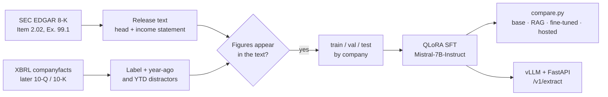

# FinSight: earnings releases to structured data in about a second, with a fine-tuned 7B model

When a company reports a quarter, its press release hits SEC EDGAR and every desk that trades on earnings races
to pull out the same few numbers. FinSight fine-tunes Mistral-7B-Instruct with QLoRA on a free T4 to read a
release and return them as JSON:

```json
{"period_end": "2024-09-28", "revenue": 94930000000, "net_income": 14736000000, "eps_diluted": 0.97}
```

The question this project answers with measurements, not claims: **is a fine-tuned small model worth it compared
with prompting a base model, adding retrieval, or calling a large hosted model**, on accuracy, cost per release
and latency? The labels needed to train and test it are free: weeks after each release, the company files the
same figures in machine-readable XBRL, which the SEC publishes.

[Design doc](docs/DESIGN.md) · [Production path](docs/PRODUCTION.md)

| Step | Notebook | Runtime |
|---|---|---|
| 1. Build the dataset from SEC EDGAR | [](https://colab.research.google.com/github/PujaSridhar/finsight/blob/main/notebooks/01_build_dataset.ipynb) | CPU, 30–60 min |
| 2. QLoRA fine-tuning | [](https://colab.research.google.com/github/PujaSridhar/finsight/blob/main/notebooks/02_train_qlora.ipynb) | T4, ~3–4 h |
| 3. Compare: base, RAG, fine-tuned, hosted | [](https://colab.research.google.com/github/PujaSridhar/finsight/blob/main/notebooks/03_compare.ipynb) | T4, ~1 h per system |
| 4. Demo | [](https://colab.research.google.com/github/PujaSridhar/finsight/blob/main/notebooks/04_demo.ipynb) | T4 |
| 5. Serve with vLLM | [](https://colab.research.google.com/github/PujaSridhar/finsight/blob/main/notebooks/05_serve.ipynb) | T4 |

## Results

> **TODO (fill in after notebooks 1–3):** paste `results/compare/COMPARISON.md` here and add
> `results/loss_curve_earnings.png`. The cells below are placeholders, not measurements.

Held-out releases from companies never seen in training, same instruction for every system.

| System | All 4 fields right | Revenue | Net income | Diluted EPS | Period | Cost per 1K releases | p50 latency | p95 latency |
|---|---|---|---|---|---|---|---|---|
| Base Mistral-7B-Instruct | _TBD_ | _TBD_ | _TBD_ | _TBD_ | _TBD_ | _TBD_ | _TBD_ | _TBD_ |
| Base + 2 retrieved examples (RAG) | _TBD_ | _TBD_ | _TBD_ | _TBD_ | _TBD_ | _TBD_ | _TBD_ | _TBD_ |
| **FinSight (QLoRA)** | _TBD_ | _TBD_ | _TBD_ | _TBD_ | _TBD_ | _TBD_ | _TBD_ | _TBD_ |
| Large hosted model (Claude) | _TBD_ | _TBD_ | _TBD_ | _TBD_ | _TBD_ | _TBD_ | _TBD_ | _TBD_ |

Revenue and net income count as right within 0.5%, EPS within half a cent, period end exactly. Local latency is
one request at a time on the GPU named in the table; local cost is that GPU's hourly price times GPU seconds.
The comparison also counts *why* each wrong field is wrong: the year-ago quarter, year-to-date, off by 1,000x,
sign, a likely non-GAAP figure, or missing.

<!--  -->

## What's interesting about it

- **Free, verified labels.** Each release is labeled with the figures the company later filed in XBRL (the first
  filing, not a later restatement), and kept only if those exact figures appear in the text the model reads.
  `data/earnings/stats.json` counts every release dropped and why.
- **A test that matches the real traps.** Releases print the year-ago quarter and year-to-date next to the
  current quarter and lead with adjusted EPS; the labels include those distractor values, so the evaluation can
  say which trap a model fell into.
- **No leakage.** Train, validation and test are split by company, and the build asserts it.
- **Honest baselines.** Retrieval-augmented prompting is the strongest no-training alternative, and a large hosted
  model is the strongest alternative overall. If fine-tuning doesn't beat the first on accuracy and the second on
  cost and speed, the table will show it.
- **A production path.** vLLM serving (FP8 weights plus the LoRA adapter) behind a small API with request logging,
  a CI eval gate on every change, and a monitoring and retraining plan that uses later 10-Qs as delayed labels.
- **Runs on free hardware.** 4-bit QLoRA on a 16 GB T4, resumable training and evaluation, and a laptop is enough
  for the data build and every test.

## How it works



**Data.** `python -m finsight.earnings` takes the first 150 companies in the SEC's ticker file, finds their
earnings 8-Ks since 2019, downloads Exhibit 99.1, and cuts each release to the opening 3,000 characters plus the
income statement (about 2,500 tokens). It needs `SEC_USER_AGENT` set to your name and email, which the SEC
requires of every client. Banks and insurers mostly drop out (no standard revenue tag), and fourth quarters are
underrepresented (their quarterly figures are usually not tagged in the 10-K).

**Training.** `configs/earnings_t4.yaml`: 4-bit NF4 with double quantization, LoRA r=16 / alpha=32 on all seven
projection matrices, loss on the JSON answer only, lr 2e-4 cosine, effective batch 16, max length 3,072 (longer
examples dropped, never truncated), checkpoints every 50 steps. An optional warm-up stage on 18K verified
FinQA / TAT-QA questions (`configs/qlora_t4.yaml`, then `init_adapter`) is kept as an ablation; see the design doc.

**Comparison.** `python -m finsight.compare --system {base,rag,finetuned,hosted}` writes per-release predictions
with latency and token counts, and `--report` builds the table above. The hosted model reads
`ANTHROPIC_API_KEY` from the environment and is optional.

## Run it yourself

```bash
git clone https://github.com/PujaSridhar/finsight && cd finsight
export SEC_USER_AGENT="Your Name your.email@example.com"

# CPU / laptop: data and tests
pip install -r requirements-dev.txt
python -m finsight.earnings --companies 5 --out data/earnings_check     # 2-minute check
python -m finsight.earnings                                             # full build
python -m pytest -q

# GPU (T4 or better)
pip install -r requirements.txt
huggingface-cli login       # Mistral-7B-Instruct-v0.3 is gated: accept its terms on Hugging Face first
python -m finsight.train --config configs/earnings_smoke.yaml           # 10-minute check
python -m finsight.train --config configs/earnings_t4.yaml              # add --resume after a disconnect
python -m finsight.compare --system base
python -m finsight.compare --system rag
python -m finsight.compare --system finetuned --adapter outputs/finsight-earnings/final
ANTHROPIC_API_KEY=... python -m finsight.compare --system hosted        # optional
python -m finsight.compare --report --gpu-hourly-usd <your GPU price>
python app.py --adapter outputs/finsight-earnings/final --compare --share

# Serving (fresh environment)
pip install -r requirements-serve.txt
bash scripts/serve_vllm.sh outputs/finsight-earnings/final
python -m finsight.serve --backend vllm
```

## Repository layout

```
finsight/
  edgar.py       SEC EDGAR client, HTML to text, release excerpt
  earnings.py    the task: schema, prompt, XBRL labels, verification, scoring, dataset build
  tasks.py       one interface over the earnings task and the QA warm-up task
  train.py       QLoRA fine-tuning with loss on the answer only
  inference.py   batched generation with token counts and timing
  retrieval.py   BM25 few-shot retrieval for the RAG baseline
  compare.py     base vs RAG vs fine-tuned vs hosted: accuracy, cost, latency
  serve.py       FastAPI service in front of vLLM (or an in-process model)
  ci_eval.py     CI eval gate: re-score saved results, smoke-eval a served model
  monitor.py     daily summary of the request log
  data.py, prompts.py, metrics.py, evaluate.py, judge.py
                 optional FinQA / TAT-QA warm-up stage and its evaluation
app.py           Gradio demo: release URL or text in, JSON and timing out
configs/         training configs, prices for cost per release, eval-gate thresholds
scripts/         vLLM launch script
notebooks/       Colab notebooks for each step (00 is the original v1 data notebook)
docs/            design doc and production path
tests/           unit tests; models are replaced by stand-ins, so they run on a laptop
```

## Limitations

- A research prototype, not a trading system: no market-data integration, and nothing it outputs is advice.
- Four fields. Adjusted EPS and guidance are what traders watch most, but XBRL doesn't label them; that is the
  next step in the design doc.
- Coverage leans to large US companies and to the first three quarters of the fiscal year, and mostly excludes
  banks and insurers.
- A few hundred test releases give a few points of sampling error; compare systems on the same releases.

## Data and credits

- [SEC EDGAR](https://www.sec.gov/edgar) filings and the [XBRL companyfacts API](https://www.sec.gov/search-filings/edgar-application-programming-interfaces);
  downloaded at build time under the SEC's fair-access rules, not redistributed here.
- Warm-up data: [FinQA](https://github.com/czyssrs/FinQA) (MIT), [TAT-QA](https://github.com/NExTplusplus/TAT-QA)
  (CC BY 4.0), and [FinanceBench](https://github.com/patronus-ai/financebench) for evaluation only.
- [QLoRA](https://arxiv.org/abs/2305.14314); base model
  [Mistral-7B-Instruct-v0.3](https://huggingface.co/mistralai/Mistral-7B-Instruct-v0.3); serving with
  [vLLM](https://github.com/vllm-project/vllm).
