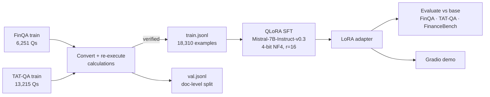

# FinSight: fine-tuning Mistral-7B to reason over financial filings

FinSight teaches a 7B open model to answer numerical questions about 10-K tables and text, showing each
calculation step, using QLoRA on a single free T4 GPU. It is evaluated against the base model on held-out
FinQA and TAT-QA questions and on FinanceBench, an out-of-domain benchmark it never trains on.

| Phase | Notebook | Runtime |
|---|---|---|
| 1. Build the dataset | [](https://colab.research.google.com/github/PujaSridhar/finsight/blob/main/notebooks/01_build_dataset.ipynb) | CPU, ~1 min |
| 2. QLoRA fine-tuning | [](https://colab.research.google.com/github/PujaSridhar/finsight/blob/main/notebooks/02_train_qlora.ipynb) | T4, ~2–3 h |
| 3. Evaluation | [](https://colab.research.google.com/github/PujaSridhar/finsight/blob/main/notebooks/03_evaluate.ipynb) | T4, ~2 h |
| 4. Demo | [](https://colab.research.google.com/github/PujaSridhar/finsight/blob/main/notebooks/04_demo.ipynb) | T4 |

## Results

> **TODO (fill in after running notebooks 02 and 03):** paste `results/RESULTS.md` here and add
> `results/loss_curve.png`. Numbers below are placeholders, not measurements.

| Test set | n | Base Mistral-7B-Instruct | FinSight (QLoRA) | Change |
|---|---|---|---|---|
| FinQA test (in-domain) | 300 | _TBD_ | _TBD_ | _TBD_ |
| TAT-QA dev (unseen filings) | 300 | _TBD_ | _TBD_ | _TBD_ |
| FinanceBench (out-of-domain) | 150 | _TBD_ | _TBD_ | _TBD_ |

Accuracy = the final `Answer:` matches the gold answer (numbers within 1%, percent and decimal forms treated as
equal; yes/no and spans by normalized match). Both models get the identical prompt and greedy decoding.

<!--  -->

## What's interesting about it

- **Verified training labels.** Targets are built from the human-written calculation programs in FinQA and the
  derivations in TAT-QA, then re-executed; an example is kept only if the re-executed calculation reproduces the
  gold answer. The model learns to show steps like `Step 2: 3,886 / 32,730 = 0.11873` before `Answer: 11.9%`.
- **No benchmark contamination.** FinanceBench is held out entirely as an out-of-domain test. TAT-QA is split
  by document, so no filing appears in both training and validation, and the build asserts that no test question
  appears in the training set.
- **Loss on the answer only.** The filing excerpt is ~95% of each sequence; the prompt tokens are masked out of
  the loss so training spends its signal on reasoning, not on memorising 10-K text.
- **Runs on free hardware.** 4-bit NF4 base weights + LoRA on all linear layers fit a 16 GB T4 at 2,048 tokens.
  Training and evaluation both checkpoint and resume, so a dropped Colab session costs minutes, not hours.
- **Tested.** Metric, label-building and evaluation code have unit tests (the evaluation pipeline is tested
  end to end with a mocked model) that run in CI on every push.

## How it works



### Data (Phase 1)

`python -m finsight.data` downloads the original releases from GitHub and writes `data/processed/`:

| Split | Examples | Source |
|---|---|---|
| train | 18,310 | FinQA train (5,979) + TAT-QA train (12,331) |
| val | 400 | FinQA dev + held-out TAT-QA filings |
| test_finqa | 300 | sampled from FinQA test |
| test_tatqa | 300 | sampled from TAT-QA dev |
| test_financebench | 150 | all open-source FinanceBench questions |

Dropped from the training sources: 348 examples whose context exceeds ~1,700 tokens and 108 whose calculation
did not reproduce the gold answer (`data/processed/stats.json` has the breakdown). Training samples 4,000 of the
18,310 by default to fit a T4 time budget; `max_train_examples` in the config raises it.

Each record:

```json
{"context": "<10-K text before the table>\n\n| | 2018 | 2017 |\n|---|---|---|\n| Total net revenues | $36,616 | $32,730 | ...",
 "question": "what is the growth rate in net revenues in 2018?",
 "response": "Step 1: 36,616 - 32,730 = 3,886\nStep 2: 3,886 / 32,730 = 0.11873\nAs a percentage: 0.11873 × 100 = 11.9%\nAnswer: 11.9%",
 "answer": "11.9%"}
```

### Training (Phase 2)

`configs/qlora_t4.yaml`: Mistral-7B-Instruct-v0.3, 4-bit NF4 with double quantization, LoRA r=16 / alpha=32 /
dropout 0.05 on q, k, v, o, gate, up and down projections, lr 2e-4 cosine with 3% warmup, effective batch 16,
1 epoch, paged 8-bit AdamW, fp16, gradient checkpointing, max length 2,048 (longer examples dropped rather than
truncated).

### Evaluation (Phase 3)

`python -m finsight.evaluate` scores the base model and the adapter on the three test sets and writes
per-question predictions to `results/predictions/`, per-model metrics to `results/metrics_*.json`, and a
comparison table to `results/RESULTS.md`. It reports accuracy, numeric accuracy, exact match, token F1 and how
often the model produced a parseable `Answer:` line, with breakdowns by TAT-QA answer type and FinanceBench
question type. Two thirds of FinanceBench answers are free-text analysis, so an optional LLM judge
(`python -m finsight.judge`) grades those against the gold answer.

## Run it yourself

```bash
git clone https://github.com/PujaSridhar/finsight && cd finsight

# CPU: data + tests
pip install -r requirements-dev.txt
python -m finsight.data
python -m pytest -q

# GPU (T4 or better)
pip install -r requirements.txt
huggingface-cli login          # Mistral-7B-Instruct-v0.3 is gated: accept its terms on Hugging Face first
python -m finsight.train --config configs/smoke_test.yaml      # 10-minute check
python -m finsight.train --config configs/qlora_t4.yaml        # full run (add --resume after a disconnect)
python -m finsight.evaluate --tag base
python -m finsight.evaluate --tag finetuned --adapter outputs/finsight-mistral-7b-qlora/final
python -m finsight.evaluate --report
python app.py --adapter outputs/finsight-mistral-7b-qlora/final --compare --share
```

## Repository layout

```
finsight/
  prompts.py     one prompt builder shared by training, evaluation and the demo
  data.py        Phase 1: download, convert, verify, split
  train.py       Phase 2: QLoRA fine-tuning with response-only loss
  inference.py   batched generation with the base model or base + adapter
  evaluate.py    Phase 3: scoring, resumable predictions, results table
  metrics.py     answer parsing, numeric tolerance, EM / F1
  judge.py       optional LLM judge for free-text FinanceBench answers
app.py           Phase 4: Gradio demo (side-by-side with the base model)
configs/         T4 training config and a smoke-test config
notebooks/       Colab notebooks for each phase (00 is the original v1 data notebook)
tests/           unit tests + mocked end-to-end evaluation test
```

## Limitations

- FinQA text is lower-cased and tokenized in the original release, so the model sees slightly unnatural text.
- Answers are grounded in a provided excerpt; there is no retrieval over full filings (a natural next step).
- 300-question test samples give roughly ±3 points of sampling error on accuracy; report differences with that
  in mind, or run the full 1,147-question FinQA test with `--n-test`.
- The model is a research demo, not financial advice.

## Possible next steps

- Retrieval over full 10-K PDFs (chunking + embeddings) so the demo works on any filing, not a pasted excerpt.
- Compare against few-shot prompting of the base model and a larger model, to show what fine-tuning buys.
- Train longer on the full 18K examples on a bigger GPU, or try DPO on the model's own wrong answers.

## Data and credits

- [FinQA](https://github.com/czyssrs/FinQA) (Chen et al., EMNLP 2021), MIT License.
- [TAT-QA](https://github.com/NExTplusplus/TAT-QA) (Zhu et al., ACL 2021), CC BY 4.0.
- [FinanceBench](https://github.com/patronus-ai/financebench) (Islam et al., 2023), open-source sample of 150
  questions; see its repository for terms. Used for evaluation only.
- [QLoRA](https://arxiv.org/abs/2305.14314) (Dettmers et al., 2023); base model
  [Mistral-7B-Instruct-v0.3](https://huggingface.co/mistralai/Mistral-7B-Instruct-v0.3).

Datasets are downloaded at build time and are not redistributed in this repository.
