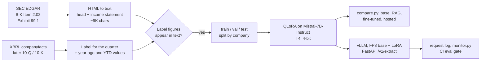

# FinSight design doc

Status: research prototype. Every number in the results section of the README comes from running the code in this
repo; nothing here is a measurement until those runs exist.

## 1. Problem

When a US public company reports a quarter, it files its earnings press release with the SEC on Form 8-K
(Item 2.02, usually as Exhibit 99.1), often minutes before or after the market sees it. The first few figures
everyone needs from it are the same every time: revenue, GAAP net income, GAAP diluted EPS, and which quarter they
belong to.

Getting those right is harder than it looks, and the traps are specific:

- The release prints the year-ago quarter and year-to-date totals next to the current quarter.
- The headline usually leads with **adjusted** (non-GAAP) EPS; the GAAP figure is further down.
- Tables are "in millions" or "in thousands", and losses are in parentheses.
- Every company lays the release out differently, so a template parser breaks on the next company.

FinSight turns a release into a fixed JSON record:

```json
{"period_end": "2024-09-28", "revenue": 94930000000, "net_income": 14736000000, "eps_diluted": 0.97}
```

## 2. Users and what they need

Trading and quant research desks that react to earnings. For them the record is only useful if it is:

- **Fast:** seconds, not tens of seconds. The value of an earnings number decays quickly after release; firms pay
  for low-latency data feeds for exactly this reason.
- **Cheap per release:** a few thousand US companies report four times a year, and in peak weeks hundreds report
  on the same morning. Cost per release times volume matters, as does being able to run many at once.
- **Right in the specific ways above:** a fast wrong number is worse than no number.
- **Self-hosted:** firms are often unwilling to send what they process, and how, to a third-party API.

The honest limit: these users are firms, not individual investors, and FinSight is a prototype that shows the
approach. It is not a trading system, has no market-data integration, and nothing it outputs is investment advice.

## 3. Why a fine-tuned small model

There are three ways to build this, and the comparison harness (`finsight/compare.py`) measures all of them on
the same held-out releases:

| Approach | What it costs | Expected weakness |
|---|---|---|
| Large hosted model (e.g. Claude) with a good prompt | Per-token price on ~2,500 input tokens per release; network round trip; data leaves your systems | Probably the most accurate, but the slowest and most expensive per release |
| Base 7B model with a prompt, or with retrieved worked examples (RAG) | One GPU; RAG makes every prompt 2-3x longer | Confuses adjusted with GAAP EPS, picks the wrong column or scale |
| **Fine-tuned 7B (FinSight)** | One GPU and a few hours of training; same short prompt as the base model | Needs labeled data and retraining when formats drift |

The bet is that fine-tuning moves a 7B model from the second row's accuracy toward the first row's, while keeping
the second row's speed and cost, and without a long few-shot prompt. That bet is falsifiable: if the fine-tuned
model does not beat RAG on accuracy, or the hosted model is already fast and cheap enough, fine-tuning is not
worth it, and the README should say so.

What makes fine-tuning practical here is that **labels are free and verifiable**. Weeks after the release, the
company files the same quarter's figures in its 10-Q or 10-K in XBRL, which the SEC publishes through its
companyfacts API. No hand labeling.

## 4. System



- `finsight/edgar.py`: EDGAR client (identifies itself with your `SEC_USER_AGENT`, stays under the SEC's rate
  limit, caches everything), HTML to text that keeps table rows intact, and the excerpt the model reads.
- `finsight/earnings.py`: the schema, prompt, XBRL labeling, verification, scoring and error analysis, and the
  dataset build.
- `finsight/train.py`: QLoRA with loss on the JSON answer only.
- `finsight/compare.py`: the four-way comparison on accuracy, cost per release and latency.
- `finsight/serve.py`, `scripts/serve_vllm.sh`, `finsight/ci_eval.py`, `finsight/monitor.py`: the production
  path, described in [PRODUCTION.md](PRODUCTION.md).

## 5. Key decisions and tradeoffs

**Labels from XBRL, kept only if they appear in the release.** XBRL gives the right number for the right quarter
from the company itself. But the release and the 10-Q can disagree (a restatement, a different revenue line, a
release that covers something else), so an example is kept only when the labeled revenue, net income and EPS are
literally printed in the excerpt the model will read. This throws away some good examples to avoid training on
wrong ones; the build's `stats.json` reports how many each rule removed. The first-filed XBRL value is used, so a
later restatement does not overwrite what the release said.

**Four fields, not more.** Revenue, GAAP net income, GAAP diluted EPS and period end are the fields XBRL can label
reliably. Adjusted EPS and next-quarter guidance are what traders care about most, but neither is in XBRL, so
there is no free answer key. Labeling them would mean hand-labeling or labeling with a large model and
spot-checking; that is the first extension (section 8), deliberately not built until the four verifiable fields
work. Asking for GAAP EPS still tests the adjusted-vs-GAAP trap: a model that returns the headline adjusted figure
is scored wrong, and the error analysis counts it as `likely_non_gaap`.

**Split by company.** Test releases come from companies never seen in training, so the score measures reading
an unfamiliar layout, not memorizing a company's template. This is harsher than production (where you would have
each company's past releases) and is the honest version of the number.

**An excerpt, not the whole release.** Releases run 20K to 100K characters. The figures live in the first page
and the income statement, so the model reads the opening 2,000 characters plus the income statement, 6,000
characters or about 2,650 tokens (release text averages 2.3 characters per Mistral token; a first cut at 9,000
characters came to ~4,000 tokens and didn't fit the T4 training length). That keeps training on a T4 and keeps latency down. Cost: a release that only reports
a figure elsewhere (say, in a segment table) is dropped at build time and could be missed at serving time.

**JSON out, no reasoning steps.** The QA warm-up task trains step-by-step answers; this task does not. The output
is ~50 tokens, which is most of why a 7B model can answer in about a second once the prompt is read. Accuracy
comes from the fine-tuning instead of from long generations.

**Same prompt for every system.** Base, RAG, fine-tuned and hosted models all get the same instruction, so the
comparison measures the model, not prompt engineering. The hosted model could do better with its own structured
output mode; the README should note that rather than tune one side.

**QLoRA on a free T4.** 4-bit NF4 base weights and LoRA (r=16) on all linear layers fit Mistral-7B and a
3,072-token sequence in 16 GB. Training checkpoints every 50 steps so a dropped Colab session is resumable.

**FinQA / TAT-QA warm-up is optional, and off by default.** The earlier version of this project fine-tuned on
18K verified numerical questions over 10-K tables. That is related practice (reading financial tables, scale
words, negatives in parentheses), and `init_adapter` in `configs/earnings_t4.yaml` lets the earnings run start
from that adapter. It costs about three more GPU hours, so it is kept as an ablation, not a requirement: if
warm-up then earnings does not beat earnings alone on the earnings test set, it should be dropped.

**FP8 for serving, NF4 for training.** vLLM no longer serves bitsandbytes 4-bit weights, so the served base is
quantized to FP8 at load time (about 7.5 GB) with the LoRA adapter on top. The adapter was trained against an NF4
base, so serving numbers can differ slightly from training-time evaluation; the CI gate measures the served
endpoint for that reason.

## 6. Evaluation

- **Test set:** up to 300 releases from held-out companies (the comparison defaults to 100 per system to keep
  each local run near an hour on a T4).
- **Field accuracy:** period end must match exactly; revenue and net income within 0.5%; EPS within half a cent.
  Release accuracy is the share of releases with all four right.
- **Valid JSON rate**, since an unparseable answer is a failure in production.
- **Error causes** for every wrong field: year-ago quarter, year-to-date, scale (off by 1,000x), sign,
  likely non-GAAP, missing, other. These test the specific claims in section 1.
- **Latency:** p50 and p95 per release, one request at a time, on a named GPU.
- **Cost per 1,000 releases:** hosted model by its token price (`configs/pricing.yaml`); local models by GPU
  price times GPU seconds (you supply the price, because "free Colab" is not a real price).

## 7. Risks and how they are handled

| Risk | Mitigation |
|---|---|
| Wrong labels (period mismatch, restatement, other revenue line) | Verified-in-text filter; first-filed XBRL value; outcomes counted in `stats.json` |
| Leakage between train and test | Company-level split, asserted at build time |
| Small test set gives noisy numbers | Report n and the ±5-point sampling error; compare systems on the same releases |
| Survivorship and coverage bias: big US companies, Q1-Q3 overrepresented (Q4 is usually only in the 10-K's annual figures), banks mostly excluded (no standard revenue tag) | Stated as a limit; the universe size is a flag |
| Release formats drift over time | Monitoring of null-field and invalid-JSON rates; retraining loop in PRODUCTION.md |
| Overstating a prototype | No invented numbers; this doc and the README say what was and was not measured |
| SEC access rules | Client identifies itself with the user's own `SEC_USER_AGENT`, stays under 10 requests/second, caches |

## 8. What comes next

1. Adjusted EPS and next-quarter guidance: label a few hundred releases with a large model, spot-check a sample by
   hand, measure label accuracy, then add the fields.
2. Same-company retrieval for the RAG baseline (the previous quarter's release and its answer), which is what a
   real deployment would have.
3. Live evaluation (built: [LIVE.md](LIVE.md)): answer new releases as they are filed and score them when the
   10-Q arrives, which turns the one-off test set into a running measurement.
4. Latency under load: throughput and p95 with many releases at once through vLLM, which is the real case on a
   busy earnings morning.
